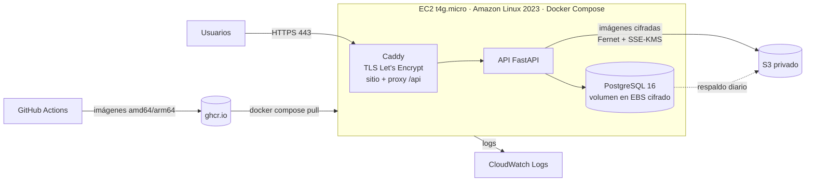

# Despliegue en AWS — Proyecto Aurora 2.5.0

Guía paso a paso para publicar Aurora en AWS con la arquitectura de **menor costo**. Sirve para la demostración del
proyecto y para un piloto con pocos usuarios. Está escrita para un **proyecto de la nueva experiencia de AWS**
(registro con Google o GitHub) en el **plan gratuito**. Todo lo que se instala está en el repositorio: `docker-compose.yml`,
`deploy/` y `.github/workflows/`.

> Antes de cargar **datos reales** de pacientes, cumpla la lista de la sección 10 y `docs/cumplimiento_legal.md`.

## 1. Arquitectura



| Pieza | Servicio | Por qué |
|---|---|---|
| Servidor | EC2 `t4g.micro` (Graviton, 1 GB + 2 GB de swap) con Amazon Linux 2023 | La opción más barata que soporta API + PostgreSQL + proxy para la demo. Si queda lenta, se cambia a `t4g.small` sin reinstalar |
| TLS y sitio | Caddy (contenedor `web`) | Certificado de Let's Encrypt automático, sin balanceador (ahorra unos USD 20 al mes) |
| Base de datos | PostgreSQL en contenedor, con respaldo diario a S3 | Más barato que RDS. Para el piloto, ver la sección 9 (RDS) |
| Imágenes | S3 privado con SSE-KMS (clave administrada por AWS `aws/s3`) | Además van cifradas por la aplicación (Fernet): doble capa. La clave `aws/s3` no tiene costo mensual |
| Logs | CloudWatch Logs (driver `awslogs`) | Auditoría operativa y diagnóstico |
| Imágenes de contenedor | GitHub Container Registry | El servidor no compila: descarga imágenes ya construidas |

**Región: `us-east-2` (Ohio).** En la nueva experiencia de AWS, la región del proyecto queda fija al crearlo, según el
país de la dirección de contacto (para Chile, `us-east-2`), y no se pueden crear recursos en otras regiones. Se
confirma en AWS Settings → *View all projects* → *Overview* → *Additional Info* → *Region*. Para usar la región de
Chile (`sa-west-1`, si está disponible) o São Paulo, hay que activar las funciones avanzadas de la cuenta o crear una
cuenta con el registro avanzado. Con datos reales, alojar en `us-east-2` es una transferencia internacional (ver
`docs/cumplimiento_legal.md`, sección 6). Con datos ficticios, para la demostración, no hay problema.

**Costo estimado (`us-east-2`):**

| Recurso | Costo al mes |
|---|---|
| EC2 `t4g.micro` encendida todo el mes | ≈ USD 6,1 |
| Disco EBS gp3 de 10 GB | ≈ USD 0,8 |
| IPv4 pública (Elastic IP) | ≈ USD 3,6 |
| S3 (pocos GB), KMS `aws/s3`, CloudWatch Logs (poco volumen) | < USD 1 |
| Dominio | USD 0 con `sslip.io` |
| **Total** | **≈ USD 11** |

En el plan gratuito no se cobra: estos montos se descuentan de los créditos (USD 100 al crear el proyecto y hasta
USD 100 más por actividades guiadas), que alcanzan para todo el plan de 6 meses. Para gastar aún menos, apague la
instancia cuando no la use: mientras está detenida solo se cobran el disco y la IP.

## 2. Preparar la cuenta (una vez)

1. **Acceso:** active MFA en la cuenta con la que inicia sesión (Google o GitHub). Los demás integrantes se invitan
   por email como *team members* desde AWS Settings, no como usuarios de IAM.
2. **Créditos y presupuesto:** revise los créditos en AWS Settings → *Billing*. En la consola de *Billing and Cost
   Management → Budgets*, cree un presupuesto mensual (por ejemplo USD 15) con alerta por correo al 80 % y al 100 %;
   crearlo también suma créditos. Si pasa al plan pagado, configure un límite de gasto en AWS Settings.
3. **Región:** en la consola, seleccione **`us-east-2`** (la del proyecto).

## 3. Clave KMS y bucket S3

1. **Clave de cifrado:** se usa la clave **administrada por AWS `aws/s3`**, que no tiene costo mensual y no hay que
   crearla. Una clave propia (*KMS → Customer managed keys*, USD 1 al mes) solo hace falta si se quiere controlar su
   política o rotarla manualmente; en ese caso, ponga su Key ID en `S3_KMS_KEY_ID` y agregue los permisos `kms:*`
   correspondientes al rol de la sección 4.
2. **S3 → Create bucket:** un nombre único (por ejemplo `aurora-imagenes-<algo-al-azar>`), en `us-east-2`.
   - *Block all public access*: **activado**.
   - *Default encryption*: **SSE-KMS** con la clave `aws/s3`, y *Bucket Key* activado (abarata KMS).
   - *Bucket versioning*: activado (protege contra borrados accidentales).
3. **Lifecycle rule** del bucket: prefijo `backups/`, borrar versiones actuales a los 35 días y las no actuales a
   los 7 días.

## 4. Rol IAM de la instancia (sin claves de acceso)

La instancia obtiene sus credenciales del rol. **Nunca** ponga claves de AWS en `deploy/.env`.

1. **IAM → Policies → Create policy → JSON:** pegue `deploy/aws/iam-policy-ec2.json` y reemplace `NOMBRE_DEL_BUCKET`,
   `REGION` (`us-east-2`) e `ID_DE_CUENTA`. Llámela `AuroraEC2`. No necesita permisos de KMS: la clave `aws/s3` los da
   a quien puede usar el bucket.
2. **IAM → Roles → Create role:** entidad *AWS service → EC2*. Adjunte `AuroraEC2` y la política administrada
   **`AmazonSSMManagedInstanceCore`**, que permite entrar con Session Manager sin abrir el puerto 22. Llámelo
   `AuroraEC2Role`.

## 5. Red y servidor

1. **Security group `aurora-web`:** entrada TCP 80 y 443 desde `0.0.0.0/0` (y UDP 443 para HTTP/3). **Sin** puerto 22.
2. **EC2 → Launch instance:**
   - AMI: **Amazon Linux 2023 (arm64)**. Tipo: **t4g.micro** (incluido en el plan gratuito).
   - Disco: 10 GB **gp3, cifrado** (*Encrypted: yes*, con la clave administrada por AWS).
   - Security group: `aurora-web`. IAM instance profile: `AuroraEC2Role`.
   - *Advanced details → Metadata version*: **IMDSv2 only**.
   - *User data*: pegue el contenido de `deploy/aws/ec2-user-data.sh`, que instala Docker, Compose y swap.
   - Par de claves SSH: no hace falta (se entra con Session Manager).
3. **Elastic IP:** asígnela a la instancia (la IP pública no cambia al reiniciar).
4. **DNS:** cree un registro `A` de su dominio (por ejemplo `aurora.midominio.cl`) que apunte a la Elastic IP. Para
   una demostración sin dominio propio se puede usar `<ip-con-guiones>.sslip.io`. Ese dominio es compartido, así que
   Let's Encrypt puede limitarlo; para algo estable, use un dominio propio.

## 6. Publicar las imágenes

En GitHub: *Actions → Publicar imágenes → Run workflow*, o cree un tag:

```bash
git tag v2.5.0
```

```bash
git push origin v2.5.0
```

Esto publica `ghcr.io/<usuario>/proyecto-aurora-backend` y `-web` para amd64 y arm64. Si el repositorio es privado,
el servidor necesitará `docker login ghcr.io` con un token de solo lectura (`read:packages`).

## 7. Instalar Aurora en el servidor

Entre con **Session Manager** (EC2 → la instancia → *Connect → Session Manager*) y ejecute:

```bash
sudo su - ec2-user
```

```bash
cd /opt/aurora && git clone https://github.com/conEFE/Proyecto-Aurora.git . && cp deploy/.env.example deploy/.env && chmod 600 deploy/.env
```

Genere los secretos (cada uno distinto) y complete `deploy/.env` con `nano deploy/.env`:

```bash
python3 -c "import secrets; print(secrets.token_urlsafe(48))"
```

```bash
python3 -c "import base64, os; print(base64.urlsafe_b64encode(os.urandom(32)).decode())"
```

| Variable | Valor en producción |
|---|---|
| `POSTGRES_PASSWORD`, `SECRET_KEY` | Un valor del primer comando para cada una |
| `ENCRYPTION_KEY` | El valor del segundo comando |
| `SITE_ADDRESS` | `aurora.midominio.cl` |
| `PUBLIC_URL` | `https://aurora.midominio.cl` |
| `AURORA_IMAGE_PREFIX` / `AURORA_VERSION` | `ghcr.io/<usuario-en-minúsculas>/proyecto-aurora` / `v2.5.0` |
| `STORAGE_BACKEND` / `S3_BUCKET` / `S3_KMS_KEY_ID` / `AWS_REGION` | `s3` / el bucket / vacío (usa `aws/s3`) / `us-east-2` |
| `BACKUP_BUCKET` | El mismo bucket (los respaldos van en `backups/`) |
| `AURORA_ADMIN_*` | RUT, email, nombre y una contraseña **temporal** del primer ADMIN |

Levante el sistema y cree el primer ADMIN (deberá cambiar la contraseña en su primer ingreso):

```bash
docker compose -f docker-compose.yml -f deploy/docker-compose.prod.yml --env-file deploy/.env pull
```

```bash
docker compose -f docker-compose.yml -f deploy/docker-compose.prod.yml --env-file deploy/.env up -d
```

```bash
docker compose -f docker-compose.yml -f deploy/docker-compose.prod.yml --env-file deploy/.env exec backend python init_user.py
```

Luego **borre** las variables `AURORA_ADMIN_*` de `deploy/.env`: ya no hacen falta.

**Verificación:**
- `https://aurora.midominio.cl` muestra el login con candado (certificado válido).
- `curl -sI https://aurora.midominio.cl` muestra `content-security-policy` y `strict-transport-security`.
- `https://aurora.midominio.cl/api/docs` responde 404 (documentación desactivada en producción).
- En CloudWatch → *Log groups* aparece `/aurora/prod` con los logs de `backend`, `web` y `db`.

## 8. Operación

**Respaldo diario** de PostgreSQL a S3 (cifrado con KMS):

```bash
(crontab -l 2>/dev/null | grep -v backup_db.sh | grep -v "^CRON_TZ="; echo "CRON_TZ=America/Santiago"; echo "15 3 * * * cd /opt/aurora && ./deploy/backup_db.sh >> /home/ec2-user/aurora-backup.log 2>&1") | crontab -
```

Pruebe la restauración al menos una vez: descargue un respaldo con `aws s3 cp` y cárguelo con
`gunzip -c respaldo.sql.gz | docker compose ... exec -T db psql -U aurora -d aurora` en una base vacía.

**Actualizar a una versión nueva:** publique el tag nuevo (sección 6), cambie `AURORA_VERSION` en `deploy/.env` y
repita `pull` y `up -d`. Las migraciones se aplican solas al iniciar la API.

**Rotar secretos** (si se sospecha una filtración): ver «Rotación de secretos» en el README. Con
`SECRET_KEY` nueva se cierran todas las sesiones.

**Imágenes del sistema operativo:** `sudo dnf update -y` una vez al mes y reinicio.

## 9. Variante con Amazon RDS (piloto)

Para el piloto conviene la base administrada (respaldos automáticos, parches, Multi-AZ opcional):

1. **RDS → Create database:** PostgreSQL 16, plantilla *Free tier/Dev*, `db.t4g.micro`, 20 GB gp3, **cifrado** (clave
   `aws/rds`), sin acceso público, en la misma VPC. Security group que solo acepte el 5432 desde `aurora-web`.
2. Parámetro `rds.force_ssl = 1`.
3. En `deploy/.env`: **borre** `COMPOSE_PROFILES` y defina
   `DB_DSN=postgresql+psycopg2://aurora:CLAVE@<endpoint>:5432/aurora?sslmode=require`.
4. Retención de respaldos automáticos: 7 días o más. `backup_db.sh` ya no hace falta.

Costo adicional aproximado: USD 14 al mes en `us-east-2` (`db.t4g.micro` + 20 GB), también descontable de los créditos.

## 10. Lista de control antes de usar datos reales

- [ ] Credenciales del Sprint 1 rotadas (`python -m scripts.rotate_secrets`) y el historial evaluado.
- [ ] Región decidida: `us-east-2` con la transferencia internacional documentada, o la región de Chile activando las
      funciones avanzadas. DPA de AWS aceptado (*AWS Artifact → Agreements*).
- [ ] Disco EBS, S3, respaldos (y RDS, si se usa) cifrados con KMS; TLS válido.
- [ ] Sin puerto 22 abierto; acceso por Session Manager; MFA en todas las cuentas de AWS.
- [ ] `ENABLE_API_DOCS=false` (lo fija `deploy/docker-compose.prod.yml`) y `deploy/.env` con permisos 600.
- [ ] Escaneo ZAP ejecutado (*Actions → ZAP baseline*) y hallazgos revisados.
- [ ] Respaldo y restauración probados.
- [ ] Alerta de presupuesto activa (y límite de gasto, si el proyecto pasa al plan pagado).
- [ ] `docs/cumplimiento_legal.md` revisado por el establecimiento (responsable del tratamiento).
