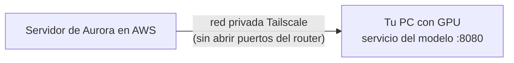

# Guía para Juan: conectar el modelo de IA a Aurora en AWS

Hola Juan 👋. La plataforma ya está en AWS (**https://13-184-207-158.sslip.io**) y el código ya está preparado para
usar tu modelo (CNN + YOLO, `backend/inference_service/`). Falta que el servidor de AWS pueda llegar a tu PC. Esta
guía es solo tu parte: unos 30–45 minutos, una sola vez.



**Cómo funciona:** cuando un médico sube una imagen, el servidor se la envía a tu PC por **Tailscale** (una red
privada entre nuestros equipos) junto con un **token**. Tu servicio responde con el resultado y la plataforma lo
muestra con el aviso **«MODELO PROTOTIPO — NO VALIDADO»**. Si tu PC está apagado, la plataforma usa la IA simulada
(marcada) y no se cae nada; cuando vuelvas, el médico puede reanalizar la imagen.

> **No abras puertos en el router.** Todo pasa por Tailscale. Y solo imágenes ficticias o de datasets públicos:
> nunca mamografías reales de personas.

---

## Antes de empezar (lo que te envía Felipe)
- [ ] La **invitación a la red de Tailscale** del equipo (llega por correo).
- [ ] El **token del modelo** (`INFERENCE_API_TOKEN`), por **mensaje directo privado**: no en el grupo ni en GitHub.

## Paso 1. Actualizar el repositorio
El servicio cambió en las versiones 2.6.0 y 2.7.0: tiene token, dependencias nuevas y Dockerfile. En la carpeta del
proyecto:

```
git checkout main
git pull origin main
```

## Paso 2. Reinstalar las dependencias del servicio
Las versiones de `requirements.txt` cambiaron (FastAPI sin vulnerabilidades, OpenCV *headless*). Con el mismo
entorno de antes:

```
cd backend
venv\Scripts\activate
pip install torch==2.6.0 torchvision==0.21.0 --index-url https://download.pytorch.org/whl/cu124
pip install -r inference_service\requirements.txt
python -c "import torch; print(torch.__version__, torch.cuda.is_available())"
```

La última línea debe mostrar `2.6.0+cu124 True`.

> Si `opencv-python` (la versión anterior, con interfaz gráfica) queda instalada junto con la *headless*, desinstálala:
> `pip uninstall -y opencv-python`.

## Paso 3. Tailscale
1. Descarga e instala Tailscale para Windows: <https://tailscale.com/download/windows>.
2. Ábrelo e inicia sesión **con la cuenta con la que aceptaste la invitación** (la misma red que el servidor).
3. En <https://login.tailscale.com/admin/machines>, busca tu PC → **⋯** → **Edit machine name** → ponle
   **`aurora-modelo`**.
4. Anota tu **IP de Tailscale**, la que empieza con `100.` (aparece en el ícono de Tailscale de la barra de tareas o
   en esa misma página).

## Paso 4. Permitir el puerto 8080 solo desde Tailscale
Abre **PowerShell como administrador** y pega:

```powershell
New-NetFirewallRule -DisplayName "Aurora modelo (solo Tailscale)" -Direction Inbound -Protocol TCP -LocalPort 8080 -RemoteAddress 100.64.0.0/10 -Action Allow
```

Así solo los equipos de nuestra red de Tailscale (direcciones `100.x.x.x`) pueden llegar al servicio: ni tu red local
ni Internet.

## Paso 5. Levantar el servicio
En una terminal (cmd):

```
cd backend
venv\Scripts\activate
cd inference_service
set INFERENCE_API_TOKEN=<el token que te mandó Felipe>
uvicorn app:app --host 0.0.0.0 --port 8080
```

- `--host 0.0.0.0` es **obligatorio**: sin él, el servicio solo escucha dentro de tu PC y el servidor de AWS no
  puede llegar.
- Espera a que aparezca `Application startup complete`. La terminal debe quedar abierta mientras se use el modelo.

**Alternativa con Docker** (si tienes Docker Desktop con WSL2 y soporte de GPU): en `backend\inference_service`, crea
un archivo `.env` con la línea `INFERENCE_API_TOKEN=<el token>` y ejecuta
`docker compose -f docker-compose.gpu.yml --env-file .env up -d --build`. Queda corriendo en segundo plano y se
reinicia solo. El `.env` no se sube a GitHub (está en `.gitignore`).

## Paso 6. Probar en tu PC
En PowerShell (otra ventana):

```powershell
$t = "<el token>"
Invoke-RestMethod -Uri http://localhost:8080/health -Headers @{ Authorization = "Bearer $t" }
```

Debe responder algo como:

```
status : ok
model_version : cnn-resnet18-672x1024+yolo11s-masa-1280
device : cuda:0
clinically_validated : False
```

- Si dice `device : cpu`, PyTorch quedó sin CUDA: repite el paso 2.
- Sin el token (o con uno incorrecto) responde **401**. Así debe ser.

## Paso 7. Avisarle a Felipe
Mándale:
- tu **IP de Tailscale** (`100.x.y.z`);
- que el servicio está arriba y el `/health` respondió bien.

Felipe (o Claude) configura el servidor para usar tu modelo y prueba subiendo una imagen ficticia. En la pantalla
**Imágenes** debe aparecer «el modelo de IA (prototipo, conectado)».

---

## El día de la defensa (o cuando se use el modelo)
- [ ] PC encendido y **sin suspensión** (Windows: *Configuración → Sistema → Inicio/apagado → Suspender: Nunca*,
      mientras dure).
- [ ] Tailscale conectado (ícono activo).
- [ ] Servicio arriba (terminal del paso 5 abierta, o el contenedor de Docker corriendo).

## Si algo falla

| Síntoma | Causa y solución |
|---|---|
| Felipe ve «el modelo no responde» | PC apagado o suspendido, Tailscale desconectado o servicio abajo. Revisa los tres puntos de arriba |
| El `/health` local funciona, pero desde AWS no | Falta `--host 0.0.0.0` (paso 5) o la regla del firewall (paso 4) |
| `401 Token inválido` | El token de tu terminal no es el mismo del servidor. Vuelve a definirlo con `set` (paso 5) |
| `device: cpu` | PyTorch sin CUDA (paso 2) |
| Una imagen tarda mucho la primera vez | Normal: los modelos se cargan al iniciar el servicio y la GPU se «calienta» con la primera imagen |

**Seguridad:** el token es como una contraseña. Si se filtra, avísale a Felipe para generar uno nuevo. Más detalle
técnico (y cómo mover el modelo a AWS más adelante) en `docs/inferencia_remota.md`.

---

## Para Felipe: lo que se hace en el servidor

1. **Crear la red de Tailscale** (en <https://tailscale.com>, con tu cuenta) e invitar a Juan desde *Users → Invite
   users*.
2. **Unir el servidor** (Session Manager, como `ec2-user`):

   ```bash
   curl -fsSL https://tailscale.com/install.sh | sh
   ```

   ```bash
   sudo tailscale up --hostname aurora-ec2
   ```

   Abre el enlace que muestra y autoriza el servidor.
3. **Enviarle el token a Juan** por mensaje directo. Para verlo en el servidor:
   `grep INFERENCE_API_TOKEN /opt/aurora/deploy/.env`.
4. **Cuando Juan avise**, edita `deploy/.env` (`nano /opt/aurora/deploy/.env`):

   ```
   INFERENCE_PROVIDER=http
   INFERENCE_URL=http://<IP de Tailscale de Juan>:8080
   ```

   Usa la **IP** (`100.x.y.z`), no el nombre: desde dentro de los contenedores el nombre puede no resolverse.
   Después: `cd /opt/aurora && dc up -d`.
5. **Probar:** `curl -s -H "Authorization: Bearer <token>" http://<IP de Juan>:8080/health` desde el servidor, y
   después subir una imagen ficticia en el sitio.
