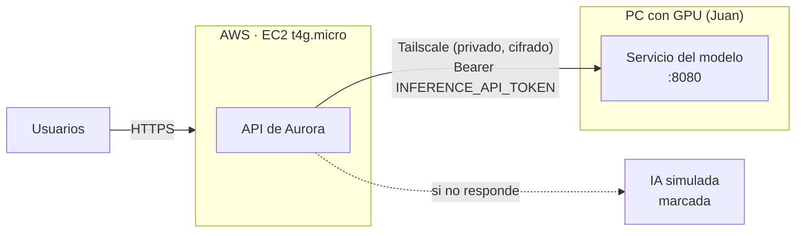

# Modelo de IA en un PC con GPU, conectado a la plataforma en AWS (opción B)

La plataforma corre en AWS (EC2 `t4g.micro`, ver `docs/despliegue_aws.md`) y el modelo (CNN + YOLO, en
`backend/inference_service/`) corre en el PC de un integrante con GPU NVIDIA. Se conectan con **Tailscale**, una red
privada entre equipos elegidos: **no se abren puertos en el router** y el servicio del modelo no queda expuesto a
Internet.



| Pieza | Costo |
|---|---|
| Plataforma en AWS | ≈ USD 11 al mes, de los créditos (ver `docs/despliegue_aws.md`) |
| Tailscale | USD 0 (plan gratuito para equipos pequeños) |
| Modelo en el PC con GPU | USD 0 (luz del PC) |

**Si el PC está apagado** la plataforma no se cae: analiza con la IA simulada (marcada «IA SIMULADA») y, cuando el
modelo vuelve, el médico usa «Analizar con el modelo» en la imagen.

> Solo datos ficticios. Un PC personal no cumple los controles que declara `docs/cumplimiento_legal.md` para datos
> reales (cifrado, respaldo, acceso controlado).

## 1. Token compartido

Genere un token una vez y guárdelo en un gestor de contraseñas (no en el repositorio):

```bash
python -c "import secrets; print(secrets.token_urlsafe(32))"
```

El mismo valor va en el PC del modelo (`INFERENCE_API_TOKEN`) y en el servidor (`deploy/.env`).

## 2. Tailscale

1. Cree una cuenta en <https://tailscale.com> (con Google o GitHub). Es una «tailnet»: la red privada del equipo.
2. **PC de Juan (Windows):** instale Tailscale desde <https://tailscale.com/download>, inicie sesión con la misma
   cuenta y, en el panel de administración (*Machines*), cambie el nombre del equipo a **`aurora-modelo`**.
3. **Servidor EC2** (por Session Manager):

   ```bash
   curl -fsSL https://tailscale.com/install.sh | sh
   ```

   ```bash
   sudo tailscale up --hostname aurora-ec2
   ```

   El comando muestra un enlace para autorizar el servidor en la tailnet.
4. **Restringir el acceso (recomendado):** en *Access controls* de Tailscale, permita que solo `aurora-ec2` (y los
   PC del equipo, para pruebas) lleguen al puerto 8080 de `aurora-modelo`.
5. Prueba desde el servidor:

   ```bash
   curl -s -H "Authorization: Bearer <el token>" http://aurora-modelo:8080/health
   ```

   Debe responder con `"device": "cuda:0"` y `"clinically_validated": false`.

## 3. Levantar el modelo en el PC

**Opción nativa** (la del README del servicio): instalar PyTorch con CUDA y las dependencias, y luego, en una
terminal:

```
cd backend\inference_service
set INFERENCE_API_TOKEN=<el token>
uvicorn app:app --host 0.0.0.0 --port 8080
```

**Opción Docker** (Docker Desktop con WSL2 y GPU), con `INFERENCE_API_TOKEN` en `backend/inference_service/.env`:

```
docker compose -f docker-compose.gpu.yml --env-file .env up -d --build
```

En el **firewall de Windows**, permita el puerto 8080 solo para la red de Tailscale (perfil privado), no para
redes públicas. **No** reenvíe el puerto 8080 en el router.

## 4. Conectar la plataforma

En el servidor, en `deploy/.env`:

```
INFERENCE_PROVIDER=http
INFERENCE_URL=http://aurora-modelo:8080
INFERENCE_API_TOKEN=<el token>
INFERENCE_TIMEOUT_SECONDS=60
INFERENCE_FALLBACK_SIMULATED=true
```

Reinicie la API (`docker compose ... up -d`). En la pantalla de carga de imágenes aparece «el modelo de IA
(prototipo, conectado)»; si dice que no responde, revise que el PC esté encendido, con Tailscale activo y el
servicio arriba.

Los contenedores usan la red del servidor para salir, así que alcanzan `aurora-modelo` a través de Tailscale. Si el
nombre no resuelve dentro del contenedor, use la IP de Tailscale del PC (`100.x.y.z`, visible en el panel).

## 5. Mover el modelo a AWS (cuando convenga)

El código no cambia: solo dónde corre el contenedor y la URL.

| Opción | Pasos | Costo aprox. |
|---|---|---|
| **Mismo servidor** | Cambiar la instancia a `t4g.medium` (4 GB), agregar `inference` a `COMPOSE_PROFILES`, `INFERENCE_URL=http://inference:8080` y `docker compose ... up -d` (descarga la imagen `-inference` publicada por GitHub Actions) | ≈ USD 28 al mes |
| **Lambda (contenedor)** | Publicar la imagen en ECR y crear una función con 3 GB de memoria y un function URL con autenticación. Requiere un adaptador HTTP→Lambda (por ejemplo AWS Lambda Web Adapter) y aceptar 10–20 s de arranque en frío | ≈ USD 0 en la demo (uso gratuito mensual de Lambda) |

En ambos casos el modelo corre en CPU: cada imagen tarda varios segundos en vez de menos de uno. Por eso
`INFERENCE_TIMEOUT_SECONDS` es de 60.
